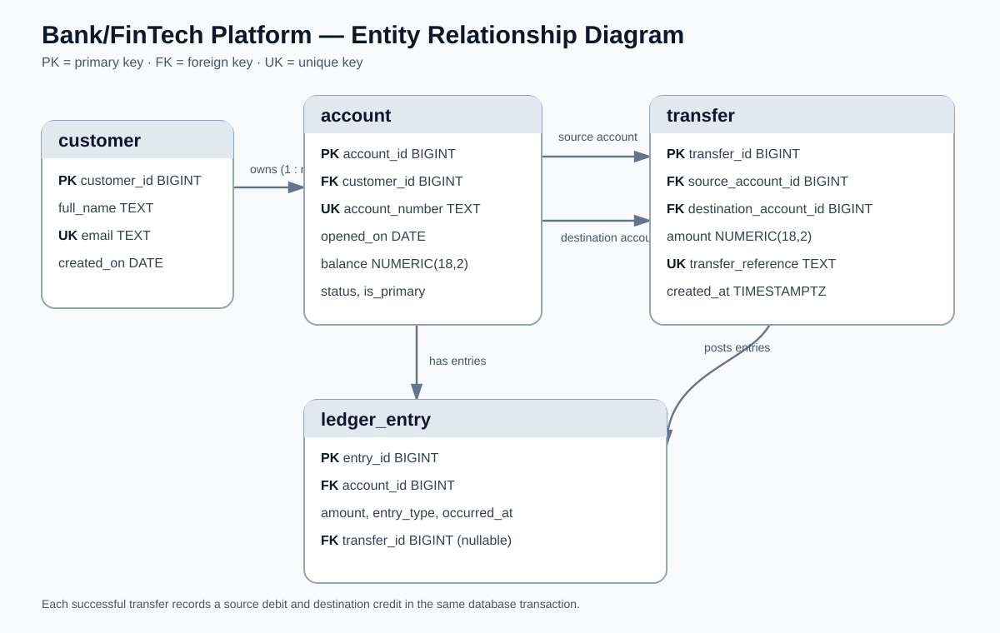

# MIT 8103 Advanced Database Systems

**Bank/FinTech Platform** · Ginikachukwu Okpala · Student ID 301922331

## Case study

The selected case study is a simulated Bank/FinTech Platform. Customers review account activity, operations staff reconcile ledger entries, and analysts summarise account activity. The relational model stores customers, accounts, transfers and debit/credit ledger entries. It supports account opening, atomic transfers, balance checks and transaction reporting. All records are fictional.

## Portfolio 1: Database Design and Modelling

The relational design contains customer, account, transfer and ledger_entry tables. It includes an ER diagram, relational schema, primary and foreign keys, unique constraints, CHECK constraints and a partial unique index that allows multiple accounts per customer while limiting each customer to one primary account. The normalisation explanation covers 1NF, 2NF and 3NF. The constraint test scripts include negative tests and a positive multiple-account test.

## Portfolio 2: Query Processing and Optimisation

The portfolio contains four SQL queries using joins, filtering and aggregation, with EXPLAIN (ANALYZE, BUFFERS) examples. A separate 50,000-row performance table is used to compare a selective timestamp lookup before and after indexing. The repository records a median change from 2.479 ms to 0.281 ms for that specific experiment. The result is environment-dependent and should be reproduced before being presented as new execution evidence.

## Portfolio 3: Transactions and Concurrency

The work demonstrates COMMIT, ROLLBACK, READ COMMITTED, a lost-update scenario and SELECT FOR UPDATE across two sessions. An additional PostgreSQL function, transfer_funds, demonstrates an atomic transfer between two accounts: it locks both accounts in a consistent order, validates funds, updates both balances, creates one transfer record and posts matching debit and credit ledger entries. The SQL file and README provide commands and expected outputs. The transfer exercise must be run locally and actual outputs captured before submission.

## Portfolio 4: NoSQL and Advanced Data Models

MongoDB stores ledger_events as event documents with a validated common structure, native BSON dates, embedded snapshots and event-specific details. The model distinguishes account_opened events (sourced from account records) from ledger_entry_recorded events (sourced from ledger entries). The script demonstrates inserts, queries, aggregation, a compound index and validation tests.

## Portfolio 5: Distributed and Cloud Database Exercise

The portfolio proposes a three-member MongoDB replica set across separate availability zones and discusses primary elections, majority acknowledgement, secondary lag, read consistency, sharding trade-offs, private networking, TLS, access control and backup recovery. It explicitly identifies this as a proposed architecture: no live cloud deployment, failover test or sharding experiment is claimed.

## Evidence files

The repository includes supporting material for each activity. The current screenshots were captured before the latest review-branch corrections; rerun the relevant scripts and replace or supplement these images with fresh outputs before final submission.

- Portfolio 1: [database results](portfolio-1-database-design/screenshots/Okpala_Ginikachukwu_301922331_P1_DatabaseResults.png) and [updated ER diagram](images/Okpala_Ginikachukwu_301922331_ERDiagram.svg).
- Portfolio 2: [query results](portfolio-2-query-optimisation/screenshots/Okpala_Ginikachukwu_301922331_P2_QueryResults.png) and [index comparison](portfolio-2-query-optimisation/screenshots/Okpala_Ginikachukwu_301922331_P2_IndexComparison.png).
- Portfolio 3: [commit/rollback](portfolio-3-transactions-concurrency/screenshots/Okpala_Ginikachukwu_301922331_P3_CommitRollback.png) and [concurrency results](portfolio-3-transactions-concurrency/screenshots/Okpala_Ginikachukwu_301922331_P3_ConcurrencyResult.png).
- Portfolio 4: [MongoDB documents and queries](portfolio-4-nosql/screenshots/Okpala_Ginikachukwu_301922331_P4_DocumentsAndQueries.png).
- Portfolio 5: [proposed distributed design](portfolio-5-distributed-cloud/screenshots/Okpala_Ginikachukwu_301922331_P5_ProposedDesign.png).

## Technical reflection

The relational design separates customer, account, transfer and ledger details to reduce duplication and preserve referential integrity. A partial unique index enforces the primary-account rule without preventing customers from holding multiple non-primary accounts. The query experiment illustrates that indexes can reduce the work required for selective lookups, while adding storage and write costs. The two-session exercise illustrates a lost update and how row locking serialises concurrent modifications. The transfer function applies those lessons to an actual banking operation. The MongoDB event model shows the flexibility of document data while also requiring care with duplicated snapshots and consistency between systems.

## AI-use declaration

I used ChatGPT to review the repository against the assessment brief, identify design and implementation issues, draft corrections, and improve the SQL, MongoDB scripts and documentation. GitHub Copilot and the portfolio generator were also used during the earlier preparation stages as previously recorded. I reviewed the changes made in this repository. The new or revised review-branch scripts have not yet been executed in a live PostgreSQL or MongoDB environment; I will run them, resolve any errors, compare actual outputs with the expected results, capture fresh screenshots and update the final PDF before submission. I remain responsible for understanding and explaining every submitted design choice, script and result.

## Repository

https://github.com/gokpala2331-stack/Okpala_Ginikachukwu_301922331

## References

- [PostgreSQL: constraints](https://www.postgresql.org/docs/17/ddl-constraints.html)
- [PostgreSQL: EXPLAIN](https://www.postgresql.org/docs/17/using-explain.html)
- [PostgreSQL: transaction isolation](https://www.postgresql.org/docs/17/transaction-iso.html)
- [PostgreSQL: explicit locking](https://www.postgresql.org/docs/17/explicit-locking.html)
- [PostgreSQL: PL/pgSQL errors and messages](https://www.postgresql.org/docs/17/plpgsql-errors-and-messages.html)
- [MongoDB: data modelling](https://www.mongodb.com/docs/manual/data-modeling/)
- [MongoDB: replication](https://www.mongodb.com/docs/manual/replication/)
- [MongoDB: sharding](https://www.mongodb.com/docs/manual/sharding/)
- [Mermaid: ER diagrams](https://mermaid.js.org/syntax/entityRelationshipDiagram.html)
