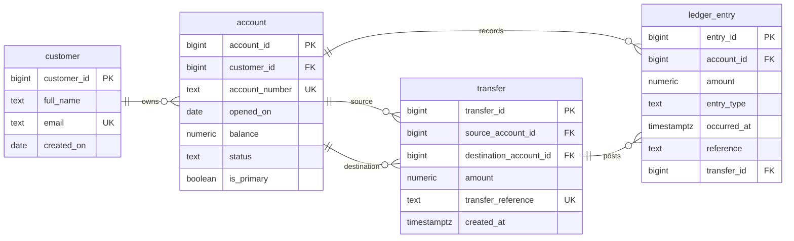

# Bank/FinTech Platform — ER diagram

The diagram shows the four relational entities. PK identifies a row, FK links to another table, and UK indicates a unique value. The two account-to-transfer relationships distinguish the source account from the destination account. A completed transfer is linked to its debit and credit ledger entries using transfer_id.
